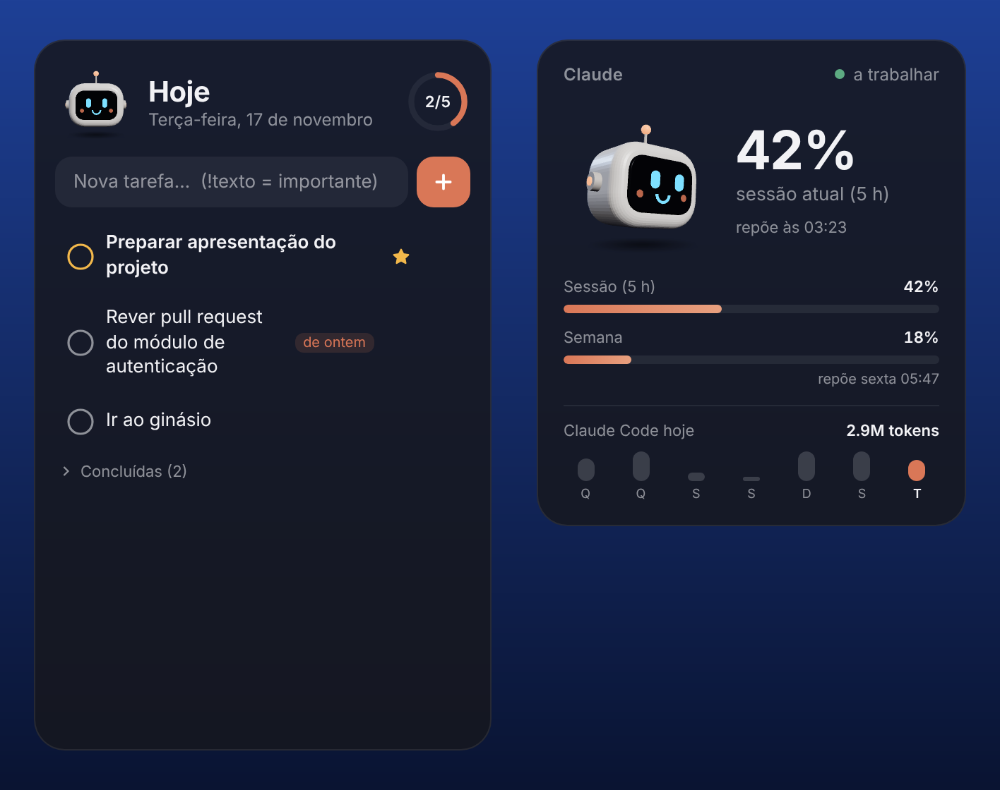

<div align="center">

# Windows Desktop Widgets

**Widgets animados para o ambiente de trabalho do Windows, ao estilo do macOS.**
Leves, discretos e integrados no desktop: ficam por baixo das janelas, fora da barra de tarefas, e lembram-se da posição em cada configuração de monitores.




</div>

---

## Índice

- [Widgets](#widgets)
  - [Tarefas](#-tarefas)
  - [Uso do Claude](#-uso-do-claude)
- [Requisitos](#requisitos)
- [Instalação](#instalação)
- [Arranque automático](#arranque-automático)
- [Configuração](#configuração)
- [Arquitetura](#arquitetura)
- [Segurança e privacidade](#segurança-e-privacidade)
- [Resolução de problemas](#resolução-de-problemas)
- [Licença](#licença)

---

## Widgets

Ambos partilham a mesma base: janela transparente presa ao ambiente de trabalho, uma mascote 3D que segue o cursor quando passas por cima, e posição guardada por configuração de monitores.

### ✅ Tarefas

Lista de tarefas do dia, sempre visível no ambiente de trabalho.

| Ação | Como |
|---|---|
| Adicionar | Escrever e <kbd>Enter</kbd> · começar com `!` marca como importante · <kbd>Ctrl</kbd>+<kbd>N</kbd> foca a caixa |
| Concluir | Clicar no círculo — visto animado, texto riscado, confettis e a mascote dá uma pirueta |
| Editar | Duplo clique no texto (<kbd>Enter</kbd> grava, <kbd>Esc</kbd> cancela) |
| Reordenar | Arrastar e largar |
| Apagar | Ícone do caixote, com **Anular** durante 5 s (ou <kbd>Ctrl</kbd>+<kbd>Z</kbd>) |
| Acesso rápido | Ícone na área de notificação: um clique traz o widget para a frente com a caixa já focada |

- **Rotina diária:** à meia-noite, as tarefas concluídas no dia anterior saem; as pendentes continuam, com a etiqueta *de ontem* / *há N dias*.
- **Progresso:** anel com feitas/total, que fica verde quando terminas tudo.
- **Mascote:** dorme quando não há tarefas, acorda quando o cursor se aproxima e festeja cada tarefa concluída.

### 🤖 Uso do Claude

Mostra o consumo do plano Claude e do Claude Code.

- **Limites do plano:** percentagem da sessão atual (janela de 5 h) e da semana, com a hora de reposição de cada uma.
- **Claude Code:** tokens do dia (input, output, cache) e histórico de 7 dias, lidos dos registos locais em `~/.claude/projects`.
- **Mascote reativa:** dorme em pausa, “trabalha” quando há atividade, sua a partir de 80 % e entra em alerta a 100 %.
- **Abre e fecha com o Claude Desktop:** um vigilante leve lança o widget quando a app arranca e fecha-o quando ela fecha (configurável).

> [!NOTE]
> Os limites do plano são lidos de um endpoint interno do claude.ai, não documentado. Se o formato mudar, o widget mostra “dados indisponíveis” em vez de números errados. Projeto pessoal, sem qualquer afiliação à Anthropic.

---

## Requisitos

- Windows 10 ou 11 (x64)
- [Node.js](https://nodejs.org/) 20 ou superior
- Para o widget de uso: conta Claude (o login é feito dentro do widget)

## Instalação

```powershell
git clone https://github.com/cristovao-lavarinhas/windows-desktop-widgets.git
cd windows-desktop-widgets
npm install          # instala dependências e compila a mascote 3D
```

Iniciar manualmente:

```powershell
npm run start:todo
npm run start:claude-usage
```

No widget de uso, clica em **Iniciar sessão no claude.ai** na primeira utilização.

## Arranque automático

Os dois widgets são independentes e instalam-se em separado. Nenhum script precisa de privilégios de administrador.

| Widget | Instalar | Mecanismo |
|---|---|---|
| Tarefas | `powershell -ExecutionPolicy Bypass -File widgets\todo\scripts\install-autostart.ps1` | Tarefa agendada no login, relançada automaticamente se terminar com erro |
| Uso do Claude | `powershell -ExecutionPolicy Bypass -File widgets\claude-usage\scripts\install-autostart.ps1` | Atalho na pasta Arranque que inicia um vigilante sem janela |

Para remover, usa o `uninstall-autostart.ps1` da mesma pasta. Os dados guardados não são apagados.

## Configuração

### Widgets (menu do botão direito)

| Opção | Descrição |
|---|---|
| Sempre por cima | Tira o widget do ambiente de trabalho e mantém-no acima das outras janelas |
| Repor posição | Volta à posição por omissão na configuração de monitores atual |
| Limpar concluídas | *(Tarefas)* remove as tarefas concluídas |
| Iniciar / terminar sessão | *(Uso do Claude)* gere a sessão do claude.ai |

### `widgets/claude-usage/config.json`

| Chave | Omissão | Descrição |
|---|---|---|
| `refreshSeconds` | `10` | Intervalo de leitura dos registos do Claude Code |
| `planRefreshSeconds` | `60` | Intervalo de consulta dos limites do plano (mínimo 30) |
| `historyDays` | `7` | Dias mostrados no histórico |
| `workingThresholdSeconds` | `120` | Tempo sem atividade até a mascote adormecer |
| `closeWithClaude` | `true` | Fechar o widget quando o Claude Desktop fecha |

---

## Arquitetura

Monorepo com [npm workspaces](https://docs.npmjs.com/cli/using-npm/workspaces): o código partilhado vive em `packages/` e cada widget é uma app Electron autónoma.

```
windows-desktop-widgets/
├── packages/
│   ├── desktop-kit/          # integração com o Windows (partilhado)
│   │   ├── desktop-embed.js  #   prende a janela ao ambiente de trabalho (Win32 via koffi)
│   │   └── placement.js      #   posição por configuração de monitores
│   └── bot3d/                # mascote 3D procedural (Three.js)
│       ├── src/bot3d.js
│       └── build.mjs         #   gera o bundle para o renderer de cada widget
├── widgets/
│   ├── todo/
│   │   ├── src/              # main.js · store.js · preload.js · renderer/
│   │   ├── assets/           # ícone da área de notificação
│   │   └── scripts/          # arranque automático
│   └── claude-usage/
│       ├── src/              # main.js · usage.js · claude-ai.js · preload.js · renderer/
│       ├── scripts/          # vigilante + arranque automático
│       └── config.json
├── scripts/
│   ├── check.mjs             # verificação de sintaxe (npm run check)
│   └── lib/                  # utilitários PowerShell partilhados
└── docs/screenshots/
```

### Decisões técnicas

| Problema | Solução |
|---|---|
| Ficar “no” ambiente de trabalho, por baixo das janelas | A janela passa a ter como *owner* o `Progman` (`SetWindowLongPtr(GWLP_HWNDPARENT)`) e é mantida no fundo da ordem Z (`HWND_BOTTOM`). Chamadas Win32 via [koffi](https://koffi.dev/), sem módulos nativos para compilar. |
| Animações congeladas | Presa ao fundo, o Chromium julga a janela tapada e suspende o `requestAnimationFrame`. A deteção de oclusão é desligada e a mascote baixa para 15 fps quando está em repouso. |
| Seguir o cursor numa janela arrastável | As zonas de arrasto não recebem eventos de rato no renderer. O processo principal lê o cursor (~30 Hz) e só o envia enquanto estiver sobre o widget. |
| Monitores que entram e saem | Cada combinação de ecrãs tem a sua posição. Os movimentos que o Windows faz durante a transição são ignorados, para não sobrescreverem a posição guardada. |
| Ler o uso do Claude Code sem custo | Leitura incremental dos `.jsonl` (só os bytes novos), com deduplicação por `message.id` + `requestId`. |
| Mascote 3D sem modelos externos | Geometria procedural (extrusões com bisel, cápsulas, toros), compilada para um bundle IIFE local, compatível com a CSP `script-src 'self'`. |

---

## Segurança e privacidade

- **Renderers isolados:** `contextIsolation`, `sandbox` e `nodeIntegration: false`, com uma API mínima exposta por `contextBridge` e CSP restritiva. A navegação e a abertura de janelas estão bloqueadas.
- **IPC validado:** o processo principal só aceita mensagens da página do próprio widget e sanitiza tudo o que recebe (tipos, tamanhos, IDs).
- **Dados apenas locais:**

  | Dados | Localização |
  |---|---|
  | Tarefas | `%APPDATA%\todo-widget\todos.json` (escrita atómica; um ficheiro corrompido é preservado, nunca apagado) |
  | Sessão do claude.ai | Partição Chromium própria em `%APPDATA%\claude-token-widget`, com os cookies encriptados pelo Windows (DPAPI) |
  | Uso do Claude Code | Lido de `~/.claude/projects`; nada é copiado nem enviado |

- **Rede:** o widget de tarefas não faz pedidos de rede. O de uso só consulta `claude.ai`, apenas em leitura, depois de iniciares sessão na página oficial de login do claude.ai.

> [!WARNING]
> A sessão do claude.ai dá acesso à tua conta. Está protegida contra quem copie os ficheiros, mas não contra software malicioso a correr na tua sessão do Windows (o mesmo nível de risco de um browser com sessão iniciada). Usa **Terminar sessão** no menu do widget para a apagar.

---

## Resolução de problemas

| Sintoma | Causa provável / solução |
|---|---|
| O widget não aparece | Pode estar fora do ecrã depois de mudares de monitores: botão direito no ícone (Tarefas) → **Repor posição**. |
| A mascote não aparece | O WebGL não está disponível. O widget de uso recorre a uma mascote 2D; o de tarefas esconde-a. |
| Uso do Claude mostra 0 tokens | Só são contadas sessões do Claude Code; as conversas no Claude Desktop/claude.ai entram nos **limites do plano**, não nos tokens. |
| “Dados do plano indisponíveis” | Sem rede, sessão expirada (inicia sessão de novo) ou o endpoint mudou de formato. |
| Diagnóstico | Logs em `%APPDATA%\todo-widget\todo.log` e `%APPDATA%\claude-token-widget\widget.log`. |

## Licença

[MIT](LICENSE) © 2026 Cristóvão Lavarinhas
